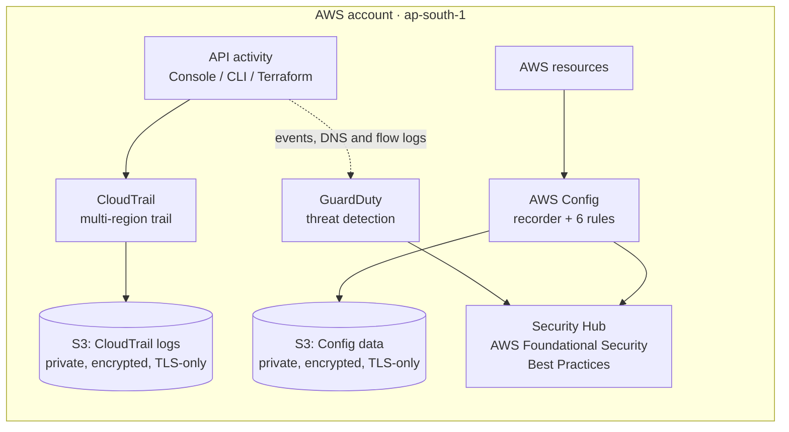

# AWS Security Baseline with Terraform


A small, reproducible **security foundation for a new AWS account**, written entirely in Terraform. It turns on audit logging, threat detection, configuration tracking, compliance rules and a central security dashboard, then proves the setup works by finding and fixing a real misconfiguration.

I built this as my first AWS project to learn core AWS security services hands-on and to practise Infrastructure as Code with security in mind.

---

## Architecture



| Question | Service that answers it |
|---|---|
| **Who did what?** | CloudTrail |
| **Is anything suspicious?** | GuardDuty |
| **What do my resources look like, and are they compliant?** | AWS Config + Config rules |
| **What is my overall security posture?** | Security Hub |

---

## What gets deployed

| Component | What it does | Security details |
|---|---|---|
| **CloudTrail** | Records API calls in all regions, including global services such as IAM | Multi-region, log file validation enabled so tampering can be detected |
| **S3 bucket for CloudTrail logs** | Stores the audit trail | Block Public Access on, AES-256 encryption, only CloudTrail may write, unencrypted uploads denied, non-HTTPS requests denied |
| **GuardDuty** | Detects threats such as credential misuse or malicious network activity | Findings published every 15 minutes |
| **AWS Config** | Records resource configurations and changes | Dedicated encrypted bucket, IAM role limited to what Config needs, non-HTTPS requests denied |
| **Config rules (6)** | Continuously check the account against best practices | See table below |
| **Security Hub** | Central dashboard that aggregates findings | Subscribed to the AWS Foundational Security Best Practices standard |

### Config rules

| Rule | Why it matters |
|---|---|
| `root-account-mfa-enabled` | The root user can do anything, so it must have MFA |
| `iam-root-access-key-check` | Root should have no access keys |
| `iam-user-mfa-enabled` | Every IAM user should use MFA |
| `cloudtrail-enabled` | Confirms audit logging is on |
| `s3-bucket-public-read-prohibited` | Flags buckets that allow public reads |
| `s3-bucket-ssl-requests-only` | Flags buckets that accept unencrypted HTTP traffic |

---

## Finding and fix: a worked example

After the first deployment, Config reported one non-compliant rule.

| | |
|---|---|
| **Finding** | `s3-bucket-ssl-requests-only` was `NON_COMPLIANT` on 2 resources, my own log buckets |
| **Risk** | Requests over plain HTTP can be intercepted in transit |
| **Fix** | Added a bucket policy statement that denies any request where `aws:SecureTransport` is `false` |
| **Result** | Rule re-evaluated as `COMPLIANT`; CloudTrail and Config delivery continue over HTTPS |

| Before | After |
|---|---|
|  |  |

The fix is a separate commit in the Git history, so the finding and its remediation are easy to follow.

---

## Repository structure

```
.
├── README.md
├── .gitignore
├── docs/                    # screenshots
└── terraform/
    ├── main.tf              # Terraform and AWS provider configuration
    ├── s3-cloudtrail.tf     # CloudTrail log bucket and its policy
    ├── cloudtrail.tf        # Multi-region CloudTrail
    ├── guardduty.tf         # GuardDuty detector
    ├── config.tf            # AWS Config recorder, bucket, IAM role
    ├── config-rules.tf      # Six managed Config rules
    ├── securityhub.tf       # Security Hub and FSBP standard
    └── .terraform.lock.hcl  # Pinned provider versions
```

---

## Getting started

### Prerequisites
- An AWS account (use a sandbox or learning account, not production)
- [AWS CLI v2](https://docs.aws.amazon.com/cli/latest/userguide/getting-started-install.html) and [Terraform](https://developer.hashicorp.com/terraform/install) 1.0 or newer
- An IAM user (not root) with MFA, and a configured CLI profile:

```bash
aws configure --profile baseline
aws sts get-caller-identity --profile baseline
```

### Deploy

```bash
git clone https://github.com/sarthak2902/AWS-Security-Baseline-terraform.git
cd AWS-Security-Baseline-terraform/terraform

export AWS_PROFILE=baseline      # PowerShell: $env:AWS_PROFILE="baseline"

terraform init
terraform plan
terraform apply
```

### Verify

```bash
# CloudTrail is logging and delivering
aws cloudtrail get-trail-status --name baseline-cloudtrail

# Config rule results
aws configservice describe-compliance-by-config-rule

# Security Hub and enabled standards
aws securityhub describe-hub
aws securityhub get-enabled-standards
```

### Clean up

The log buckets are created without `force_destroy`, so empty them before destroying:

```bash
aws s3 rm s3://cloudtrail-logs-<ACCOUNT_ID>-ap-south-1 --recursive
aws s3 rm s3://config-logs-<ACCOUNT_ID>-ap-south-1 --recursive

terraform destroy
```

---

## Cost

This project uses services that bill by usage. For a quiet learning account the cost is small, but it is not zero.

- GuardDuty and Security Hub include free trials for new accounts; afterwards they bill by usage.
- AWS Config charges per recorded configuration change and per rule evaluation.
- Set an AWS Budget alert before deploying, and destroy the stack when you are done experimenting.

---

## Design decisions

- **Dedicated bucket for Config data**, separate from CloudTrail logs, so each bucket has a simple, purpose-specific policy.
- **Least privilege** for the Config service role: the AWS managed policy for reading resources, plus a narrow inline policy to write only into its own bucket path.
- **Defence in depth on S3**: Block Public Access, default encryption, deny rules for unencrypted and non-TLS requests.
- **Security Hub default standards disabled in code** so the repository is the single source of truth for which standards are on.
- **Provider and lock file pinned** (`~> 5.0` plus `.terraform.lock.hcl`) for repeatable runs.
- **No credentials or state in Git**: `.gitignore` excludes state files, plans, variable files and keys.

## Lessons learned

- A brand-new account returned `SubscriptionRequiredException` when creating the GuardDuty detector; it succeeded once the service was available for the account.
- Terraform resource names are easy to get wrong from memory. `terraform validate` and the provider docs catch these quickly.
- A compliance rule that fails on your own infrastructure is useful: it shows the detect, fix and verify loop working.

---

## Roadmap

- [ ] Hardened workload: EC2 reachable only through SSM Session Manager (no SSH, IMDSv2, encrypted EBS), then an ECS Fargate service
- [ ] CI/CD security scanning with GitHub Actions (Checkov or tfsec for Terraform, Trivy for images)
- [ ] Auto-remediation with EventBridge and Lambda (for example, closing an open security group)
- [ ] Replace the long-lived IAM user with IAM Identity Center (SSO)
- [ ] Remote Terraform state in S3 with locking
- [ ] Customer-managed KMS keys for log encryption
- [ ] GuardDuty, Config and Security Hub in additional regions

---

## Author

**Sarthak**, cybersecurity engineer working with SAP security, GRC and DevSecOps, building hands-on cloud security skills.

- GitHub: [@sarthak2902](https://github.com/sarthak2902)

> This project is for learning and demonstration. Review and adapt it before using it in a production environment.
